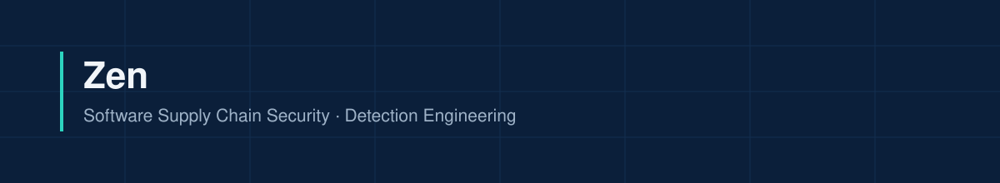

I don't stop at running security tools — I check whether their results are right.
My own analyzers and rules are tested before I trust them, and I record what failed as carefully as what worked.
Career switcher into security, with a hardware background (KAIST IDEC, 831 h of semiconductor design courses).

### What I'm working on

| Area | What I actually did |
|---|---|
| **Software supply chain** | API-BOM (CycloneDX) + SBOM (Syft → Dependency-Track) linked endpoint → code path → package → CVE. **309 of 403 CVEs (77%) unreachable** from any endpoint — measured after fixing 5 bugs in my own analyzer |
| **Detection engineering** | Wazuh rules generated from an approved OpenAPI allowlist, verified with `wazuh-logtest`. Found and fixed a deployed BOLA rule that **worked backwards** |
| **Infrastructure security** | Terraform checked without a cloud account (`terraform test` + mocks, Trivy, Checkov). Replaced an `AdministratorAccess` role with split **least-privilege** roles and an IAM action checker |
| **Next: software → kernel correlation** | Linking API endpoint → process → libraries actually loaded at runtime (strace · eBPF) → SBOM package → CVE → kernel. Today the kernel-layer graph is a static sketch |
| **Study → apply** | [openssf-study](https://github.com/zeldaim/openssf-study) — each OpenSSF concept applied to my own project and verified before / after (first: least privilege) |

### Projects

| Project | Highlight |
|---|---|
| [**Multi-Cloud DR — AWS → Azure**](https://github.com/zeldaim/multicloud-dr-petclinic) | Site-to-Site VPN · DMS · Route 53 / CloudFront failover (team). Re-verified locally: RTO 18.7 s · RPO 0 · `terraform test` 8/8 |
| [**API Security · Supply Chain**](https://github.com/zeldaim/api-security-supply-chain) | API-BOM / SBOM / VEX / reachability + automated Wazuh rules (team final project). Tested on apps not used in development: VAmPI failed (off-spec probe recall 60%) → fixed in v2.1 (93%) → **4th unseen app DVRA, config only: 15 / 15 probes caught by rules, real BOLA flagged high by ML** (ML release gate narrowly missed — recorded as is). Grafana dashboard built as code |
| [**API Defense Lab**](https://github.com/zeldaim/api-defense-lab) | A practice range for API *defenders*: a light core (vulnerable DVRA + nginx auto-block + Sigma shadow-API rules + ML BOLA detection + answer key + scorer, ~220 MB RAM) plus optional modules by job — **Wazuh** for SIEM rule authoring, **ES + Grafana** for live monitoring. Fresh-clone runs: probe blocked in 2–3 s, BOLA in ~6.5 s, **0 / 20 normal users blocked** after fixing a first-run false positive. Sigma and Wazuh verdicts match line by line (15 / 15). [Looking for testers](https://github.com/zeldaim/api-defense-lab#help-test-api-defense-lab) on Linux / macOS |
| [**SOC Detection Notes**](https://github.com/zeldaim/soc-detection-notes) | Wazuh home SOC lab — MITRE rules (T1547, T1046) and SIEM incident write-ups |
| [**ZenSOC — Wazuh → Slack**](https://github.com/zeldaim/wazuh-slack-alertbot) | Grouping cut duplicate alerts 32 → 3; the entropy hypothesis came out the opposite way — recorded as such |
| [**Enterprise Network Lab**](https://github.com/zeldaim/enterprise-network-lab) | Multi-site network in Packet Tracer: VLSM, OSPF multi-area with dual-link cost failover (primary link down → backup in one lost ping), Router-on-a-Stick vs SVI, inter-VLAN ACL (ICMP 3/13), static + OSPF split routing — 7 problems and fixes logged |

### Open source

- [wazuh/wazuh#35707](https://github.com/wazuh/wazuh/issues/35707) — Sysmon EventID 13 reaches `archives.json` but no alert fires (4.9.0); traced the rule-chain difference between Security- and Sysmon-channel events
- [wazuh/wazuh#36029](https://github.com/wazuh/wazuh/issues/36029) — custom `if_sid` rules for `windows_eventchannel` stop firing in 4.9.0 (`if_group` works); behavior change since 4.7.5, and `wazuh-logtest` differing from live `analysisd`

### Tools

- **Supply chain** — CycloneDX · VEX · Syft · Grype · Dependency-Track · Trivy · Checkov · GitHub Actions
- **Detection** — Wazuh · Event-Driven Ansible · Elasticsearch / Kibana
- **Infrastructure** — AWS · Terraform · Kubernetes · Linux · Python

### Background

- **KAIST IDEC semiconductor design training** — 67 courses · 831 h (2024.04 – 2026.03): digital design (Verilog, RTL-to-GDSII), computer architecture, AI accelerators, embedded networks (CAN · FlexRay)
- **Embedded systems coursework** — in progress

### Certifications

RHCSA · AWS Advanced Networking – Specialty · AWS Data Engineer – Associate · AWS AI Practitioner · 정보처리기사 · CKA *(in progress)*

### Writing & contact

[Substack — Signal & Threat](https://zeldaim.substack.com/) · [GitHub](https://github.com/zeldaim)
